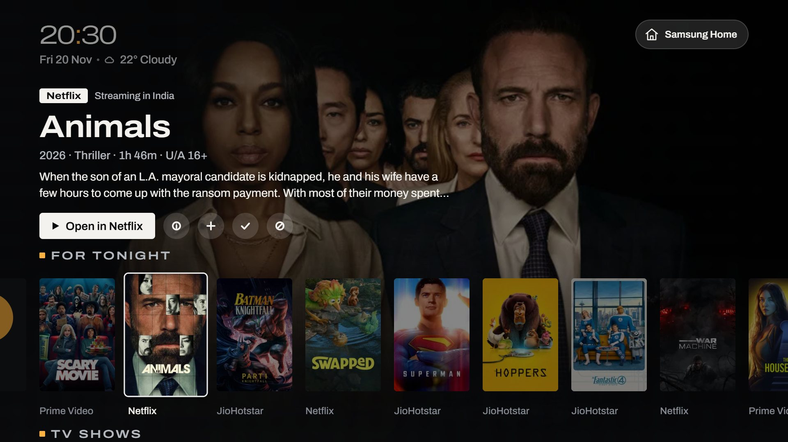
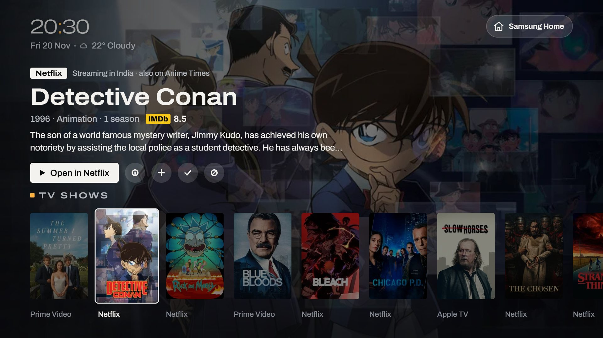
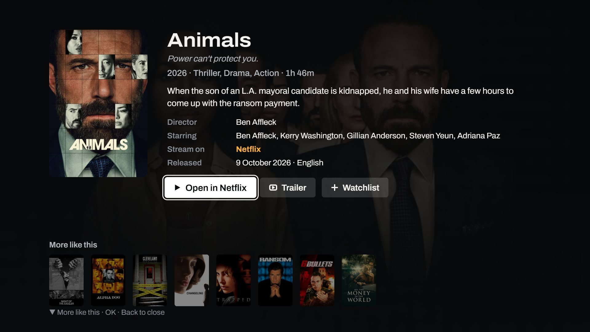
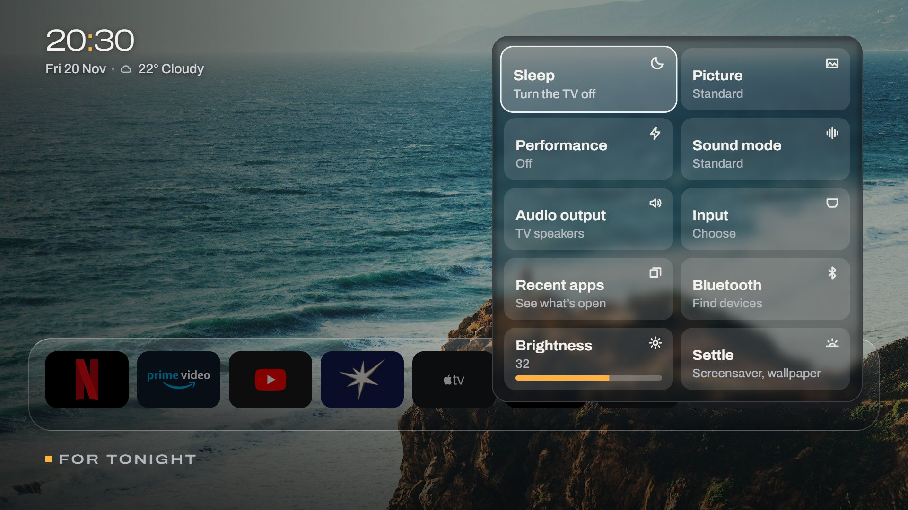
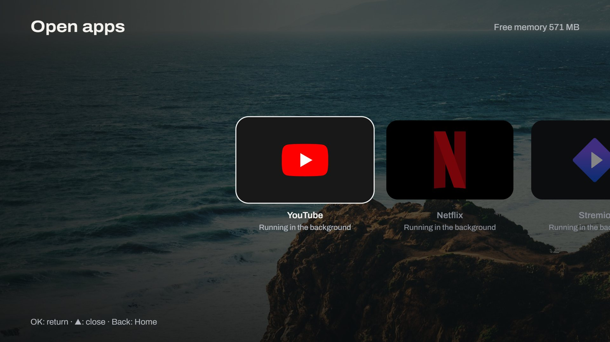

<p align="center"></p>

<h1 align="center">Settle</h1>

A calm, fast home screen for Samsung Tizen TVs. Your apps on one dock, tonight's films under it, and the TV's
settings one button away, without the ads and clutter of the stock Smart Hub.


**[Try it in your browser](https://settle-tv.vercel.app)**: the web demo, with sample apps and titles (arrow keys, Enter, Esc). 
**Install it** from the [Apps2Samsung](https://github.com/Apps2Samsung/Apps2Samsung) catalogue, under Home ([how](docs/SETUP.md#installing-from-the-apps2samsung-catalogue)), or build it yourself as below.

Settle is a plain web app (HTML, CSS and JavaScript, no framework) that you build on your computer and sideload
onto the TV. It works on its own; add free API keys to turn on recommendations and ratings, and add
[Vetro](https://github.com/andrearicci93/vetro) to make the remote's Home button open Settle and to control the TV's
picture, sound and inputs from it.

> Settle is an independent hobby project. It is not affiliated with or endorsed by Samsung, Vetro, Apps2Samsung or
> any streaming service.

## Features

| | |
| --- | --- |
| **Dock** | Your favourite apps with their real icons, a full-screen clock and weather, and a Samsung Home button for the stock home screen. Hold OK on a tile to move it. |
| **All apps** | Every installed app, A to Z, refreshed each time you open it. |
| **Up next** | The next episode of each show you're watching (from Trakt), as the first row. "Mark S2 E4 watched" moves the card on to the next episode. |
| **For tonight** | Film recommendations (Trakt picks, or TMDB's popular titles), ranked so that what you can stream on the apps you have comes first, then rentals. A fresh row every day. |
| **TV shows** | Shows streaming on your apps, without children's, news, reality, soap and talk shows. |
| **Watchlist** | Your Trakt watchlist, films and shows. |
| **Details** | Where to watch, ratings (IMDb and Rotten Tomatoes), cast, a trailer on YouTube, More like this, and Open buttons that go straight to the title in Prime Video, Apple TV or Zee5 (and a second button when another of your apps has it). |
| **Search** | Up twice from the dock. Films, shows and your installed apps; recent and trending titles before you type. |
| **App switcher** | See the apps running in the background, jump back to one, or close them to free memory (with the free-memory figure, through Vetro). |
| **Control Center** | Sleep (now or on a timer), picture mode, Performance mode, sound mode, audio output, input, recent apps, Bluetooth, brightness, and a Settle page for the screensaver, wallpaper, refresh, backup and Diagnostics. Needs Vetro. |
| **App profiles** | Per app: a picture mode, Performance mode and closing other apps when you open it from Settle, put back when you return. |
| **Screensaver** | After 2 minutes idle (adjustable), opens an Aerial-style screensaver app if you have one installed. |
| **Wallpaper** | Unsplash photos that don't repeat, with the photographer's credit. |
| **Backup** | Your dock, profiles and choices saved to your PC and restored from it (`npm run logs` on the PC). |
| **Diagnostics** | A screen that shows what Settle sees, and can send a report to your computer. |

<p>


</p>
<p>


</p>



## Getting started

Full instructions, including the TV side, are in **[docs/SETUP.md](docs/SETUP.md)**. In short:

```sh
git clone https://github.com/SherrySingh03/settle.git
cd settle
npm install
npm run setup      # asks for your (optional) API keys and TV details, writes src/js/config.local.js
npm run preview    # try it in a desktop browser at http://localhost:8080 (arrow keys, Enter, Esc)
npm run build      # makes dist/settle.wgt
```

Then install `dist/settle.wgt` on the TV with [Apps2Samsung](https://github.com/Apps2Samsung/Apps2Samsung), and
optionally install Vetro and map the Home button to Settle.

### What needs what

| Feature | Needs |
| --- | --- |
| Dock, All apps, clock, app switcher, Samsung Home button | nothing |
| Weather | nothing (Open-Meteo; your location is looked up once from your IP address, or pinned in the config) |
| Recommendations, posters, where to watch | a free [TMDB](https://www.themoviedb.org/settings/api) key |
| Personal picks, Up next, watchlist, Watched, Not interested | a free [Trakt](https://trakt.tv/oauth/applications) app (client id) |
| IMDb and Rotten Tomatoes ratings | a free [OMDb](https://www.omdbapi.com/apikey.aspx) key |
| Wallpaper | a free [Unsplash](https://unsplash.com/developers) key |
| Trailers | YouTube on the TV, paired once with its TV code (see SETUP) |
| "Trending on YouTube" above the dock (otherwise: trailers for films trending this week) | an optional [YouTube Data API](https://console.cloud.google.com/apis/library/youtube.googleapis.com) key |
| Home button opens Settle, Control Center, Performance mode, sleep timer, app profiles, free memory in the app switcher | [Vetro](https://github.com/andrearicci93/vetro) on the TV (root) |
| Backup and restore, Diagnostics reports | `npm run logs` running on your computer |

### Known limits

- **Tested on one TV**: a Samsung QN70F (2025, Tizen 9). The launcher itself should run on other Tizen TVs from
  2016 on; the layout is made for a 1080p screen.
- **Without Vetro, Settle is an app you open**, not your home screen: the remote's Home button still opens Smart Hub.
  The Vetro features need a rooted TV; Vetro supports Tizen 6 to 9, and Tizen 10 can't be rooted yet.
- **Vetro's "Require pairing" must be off**: Settle has no pairing screen yet.
- **Home pressed twice** opens the app switcher only on some TVs; **Green** always does.
- **Trailers play in the YouTube app** through YouTube's own cast protocol, which is undocumented. Settle needs the
  app's screen id, read through Vetro or set once (see SETUP); when a step fails, YouTube still opens and Settle
  says so.
- **Diagnostics reports and backups to your computer** need a package you build yourself (`npm run setup` asks for
  the address); with the catalogue package, Diagnostics is shown on screen only.
- **Your keys are inside the package**: the catalogue writes them into your copy, and `npm run build` into yours.
  Don't share your `.wgt`.
- **The catalogue package and your own build are the same app** (`SettleTv01.Settle`): installing one replaces the
  other. If you built your own, back up first (Control Center > Settle > Back up to this PC).

## Remote control

| Button | Does |
| --- | --- |
| Arrows, OK, Back | move, open, go back |
| Hold OK on a dock app | move it along the dock |
| Hold OK in All apps (or Blue) | add, replace or remove it on the dock, set its App profile, uninstall it |
| Up from the dock | full-screen clock and wallpaper; Up again opens Search (from the rightmost tile: the Samsung Home button) |
| Green | app switcher (Home twice quickly may also work: see SETUP) |
| Red, or Play/Pause twice | Control Center |
| Yellow | Diagnostics (OK there sends a report) |

## Privacy

Settle has no server and no analytics. It talks only to the services you give it keys for (TMDB, Trakt, OMDb,
Unsplash), to Open-Meteo and geojs.io for the weather, and to Vetro on the TV itself. Your keys live in
`src/js/config.local.js`, which is gitignored, and are packed into the `.wgt` you build: **keep your `.wgt` private
and never commit `config.local.js`.**

## Development

- `npm run preview` serves `src/` with stand-in data (`src/js/mock.js`, a fake app list and a fake Vetro), so
  everything can be tried with a keyboard: arrows, Enter, Esc for Back, and `d` / `c` / `g` / `e` for the
  Yellow / Red / Green / Blue keys.
- `npm run icon` redraws the icon (`src/icon.png` for the TV, `docs/img/logo.svg` and `docs/img/icon-512.png`)
  from one description of its shapes in `scripts/make-icon.mjs`.
- `npm run logs` starts a small receiver on your computer for the Diagnostics report (Yellow, then OK on the TV) and
  for backups (Control Center > Settle > Back up to this PC).
- `npm test` drives the preview with the remote's keys in Microsoft Edge (`SETTLE_BROWSER=chrome npm test` for Chrome),
  with every outside request blocked.
- `npm run tvmon -- <label>` logs the TV's memory, CPU, temperature and Wi-Fi once a second through Vetro, for comparing
  sessions (`npm run tvmon -- compare <run> <run>`).
- Design budgets the code keeps to: no framework, under 150 KB of JavaScript, under 600 DOM nodes, animations of
  transform and opacity only (200 ms or less), no timer firing more than once a second, nothing polls, text 24 px
  and up. See [CONTRIBUTING.md](CONTRIBUTING.md).

Tested on a Samsung QN70F (2025, Tizen 9). Other Tizen TVs should work for the launcher itself; the Vetro features
depend on Vetro supporting your model.

## Credits

Settle is a fork of [NelsonEU/arn0-tv](https://github.com/NelsonEU/arn0-tv). The Vetro command shapes follow
[Knikt's APL Launcher for TizenOS](https://github.com/Knikt/APL-Launcher-for-TizenOS). Thanks to the
[Vetro](https://github.com/andrearicci93/vetro) and [Apps2Samsung](https://github.com/Apps2Samsung/Apps2Samsung)
projects. This product uses the TMDB API but is not endorsed or certified by TMDB. See [NOTICE.md](NOTICE.md) for
fonts, logos and data sources.

## Licence

[MIT](LICENSE). Bundled fonts and brand marks keep their own terms (see NOTICE.md).
