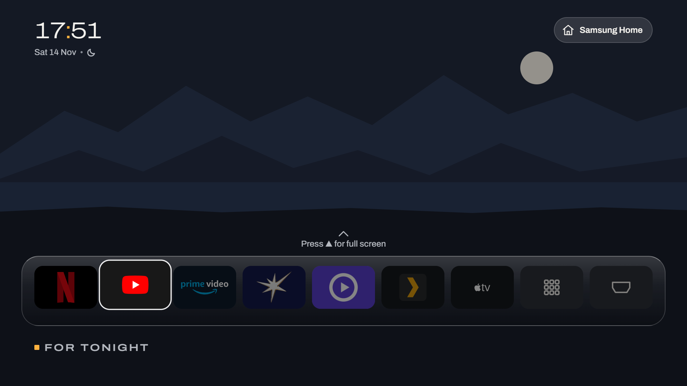
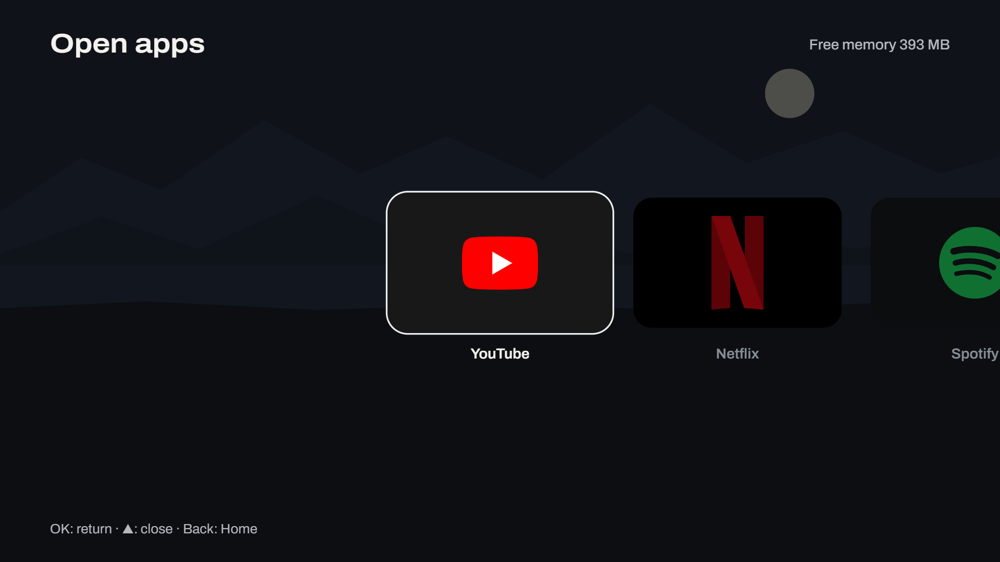

# Settle

A calm, fast home screen for Samsung Tizen TVs. Your apps on one dock, tonight's films under it, and the TV's
settings one button away, without the ads and clutter of the stock Smart Hub.



Settle is a plain web app (HTML, CSS and JavaScript, no framework) that you build on your computer and sideload
onto the TV. It works on its own; add free API keys to turn on recommendations and ratings, and add
[Vetro](https://github.com/andrearicci93/vetro) to make the remote's Home button open Settle and to control the TV's
picture, sound and inputs from it.

> Settle is an independent hobby project. It is not affiliated with or endorsed by Samsung, Vetro, Apps2Samsung or
> any streaming service.

## Features

| | |
| --- | --- |
| **Dock** | Your favourite apps with their real icons, a full-screen clock and weather, and a Samsung Home button for the stock home screen. Hold OK on a tile to move it. |
| **All apps** | Every installed app, A to Z, refreshed each time you open it. |
| **For tonight** | Film recommendations (Trakt picks, or TMDB's popular titles), ranked so that what you can stream on the apps you have comes first, then rentals. A fresh row every day. |
| **Watchlist** | A second row with your Trakt watchlist. |
| **Movie panel** | Where to watch, year, genre, runtime, age rating, IMDb rating, and buttons for Open, Watchlist, Watched (with a rating) and Not interested. |
| **App switcher** | See the apps running in the background, jump back to one, or close them to free memory (with the free-memory figure, through Vetro). |
| **Control Center** | Sleep, picture mode, sound mode, audio output, input, Wi-Fi, Bluetooth, brightness, screensaver, wallpaper, refresh. Needs Vetro. |
| **Screensaver** | After 2 minutes idle (adjustable), opens an Aerial-style screensaver app if you have one installed. |
| **Daily wallpaper** | A new Unsplash photo each day, with the photographer's credit. |
| **Diagnostics** | A screen that shows what Settle sees, and can send a report to your computer. |

<p>


</p>



## Getting started

Full instructions, including the TV side, are in **[docs/SETUP.md](docs/SETUP.md)**. In short:

```sh
git clone https://github.com/SherrySingh03/settle.git
cd settle
npm install
npm run setup      # asks for your (optional) API keys and TV details, writes src/js/config.local.js
npm run preview    # try it in a desktop browser at http://localhost:8080 (arrow keys, Enter, Esc)
npm run build      # makes dist/settle.wgt
```

Then install `dist/settle.wgt` on the TV with [Apps2Samsung](https://github.com/Apps2Samsung/Apps2Samsung), and
optionally install Vetro and map the Home button to Settle.

### What needs what

| Feature | Needs |
| --- | --- |
| Dock, All apps, clock, app switcher, Samsung Home button | nothing |
| Weather | nothing (Open-Meteo; your location is looked up once from your IP address, or pinned in the config) |
| Recommendations, posters, where to watch | a free [TMDB](https://www.themoviedb.org/settings/api) key |
| Personal picks, watchlist, Watched, Not interested | a free [Trakt](https://trakt.tv/oauth/applications) app (client id) |
| IMDb ratings | a free [OMDb](https://www.omdbapi.com/apikey.aspx) key |
| Daily wallpaper | a free [Unsplash](https://unsplash.com/developers) key |
| Home button opens Settle, Control Center, free memory in the app switcher | [Vetro](https://github.com/andrearicci93/vetro) on the TV (root) |

## Remote control

| Button | Does |
| --- | --- |
| Arrows, OK, Back | move, open, go back |
| Hold OK on a dock app | move it along the dock |
| Hold OK in All apps (or Blue) | add, replace or remove it on the dock |
| Up from the dock | full-screen clock and wallpaper (from the rightmost tile: the Samsung Home button) |
| Green | app switcher (Home twice quickly may also work: see SETUP) |
| Red, or Play/Pause twice | Control Center |
| Yellow | Diagnostics (OK there sends a report) |

## Privacy

Settle has no server and no analytics. It talks only to the services you give it keys for (TMDB, Trakt, OMDb,
Unsplash), to Open-Meteo and geojs.io for the weather, and to Vetro on the TV itself. Your keys live in
`src/js/config.local.js`, which is gitignored, and are packed into the `.wgt` you build: **keep your `.wgt` private
and never commit `config.local.js`.**

## Development

- `npm run preview` serves `src/` with stand-in data (`src/js/mock.js`, a fake app list and a fake Vetro), so
  everything can be tried with a keyboard: arrows, Enter, Esc for Back, and `d` / `c` / `g` / `e` for the
  Yellow / Red / Green / Blue keys.
- `npm run logs` starts a small receiver on your computer for the Diagnostics report (Yellow, then OK on the TV).
- Design budgets the code keeps to: no framework, under 150 KB of JavaScript, under 600 DOM nodes, animations of
  transform and opacity only (200 ms or less), no timer firing more than once a second, nothing polls, text 24 px
  and up. See [CONTRIBUTING.md](CONTRIBUTING.md).

Tested on a Samsung QN70F (2025, Tizen 9). Other Tizen TVs should work for the launcher itself; the Vetro features
depend on Vetro supporting your model.

## Credits

Settle is a fork of [NelsonEU/arn0-tv](https://github.com/NelsonEU/arn0-tv). The Vetro command shapes follow
[Knikt's APL Launcher for TizenOS](https://github.com/Knikt/APL-Launcher-for-TizenOS). Thanks to the
[Vetro](https://github.com/andrearicci93/vetro) and [Apps2Samsung](https://github.com/Apps2Samsung/Apps2Samsung)
projects. This product uses the TMDB API but is not endorsed or certified by TMDB. See [NOTICE.md](NOTICE.md) for
fonts, logos and data sources.

## Licence

[MIT](LICENSE). Bundled fonts and brand marks keep their own terms (see NOTICE.md).
